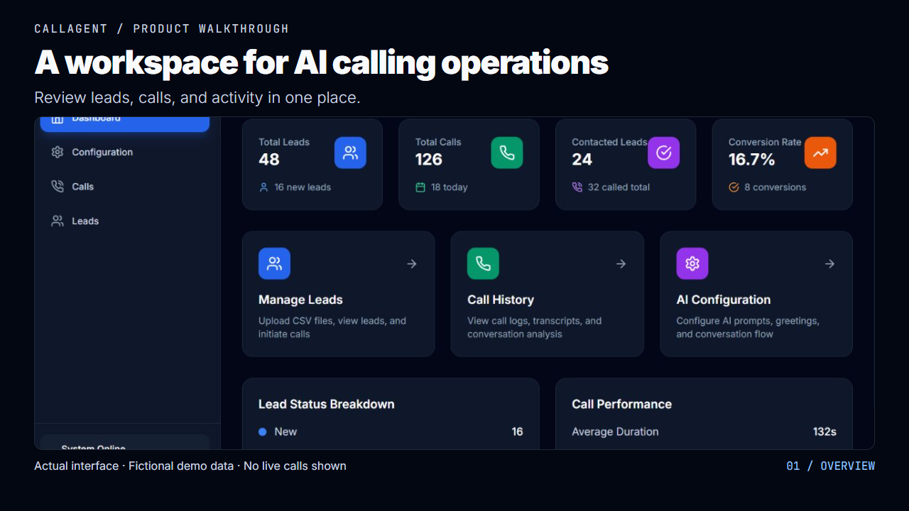
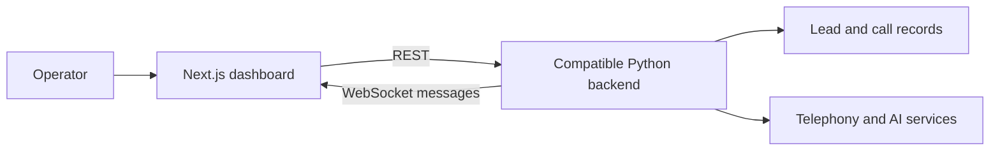

<div align="center">

# CallAgent

### A workspace for AI calling operations

Manage leads, configure an agent, and review call outcomes from one dashboard.


[Hosted frontend](https://call-agent-pi.vercel.app/) · [Companion backend](https://github.com/VanshMehta1234/CallAgent-BE) · [Developer portfolio](https://www.builtbyvansh.com/)

</div>

---

CallAgent brings lead management, agent configuration, calling controls, and call review into a single operator interface. It demonstrates the frontend side of a voice-AI system: making backend capabilities understandable and usable for the people running it.

**Repository scope:** this is the Next.js frontend. Telephony, speech processing, model execution, persistence, and call analysis depend on a compatible backend. The hosted frontend presents a sign-in screen; it is not an unrestricted product demo.

## Watch the product walkthrough

[](https://github.com/user-attachments/assets/51d52d69-d8fa-49ea-867d-919b7db276ff)

<details>
<summary><strong>Play the 26-second walkthrough inline</strong></summary>

https://github.com/user-attachments/assets/51d52d69-d8fa-49ea-867d-919b7db276ff

</details>

**[Watch or download the 26-second video (MP4)](https://github.com/VanshMehta1234/CallAgent-FE/raw/refs/heads/main/docs/media/callagent-walkthrough.mp4)** — dashboard overview, workflow shortcuts, and agent configuration. Silent, with on-screen captions.

Created from actual frontend screens captured locally with fictional demo data and a read-only fixture API. This is a guided screen tour; no live calls or production results are shown. The separate Retell project is covered below.

## Screenshots

Captured from this frontend running locally with a read-only fixture API. The numbers and DemoCare content are fictional demonstration data, not production results.

### Operations dashboard


<details>
<summary><strong>View agent configuration</strong></summary>


</details>

## Related project: Retell AI Call Agent

A separate voice-AI project focused on structured conversation flows, knowledge-base ordering, validation and recovery routes, and API/n8n actions. The public walkthrough also shows the VoiceAgent dashboard, lead management, call history, and campaign interfaces.

**Stack:** Retell AI · n8n · API integrations · workflow design

[View case study and all five product screens](https://www.builtbyvansh.com/project/ai-voice-agent) · [Open hosted application](https://ai-voice-agent-ezyk.vercel.app/dashboard)

The images below are from the existing public portfolio walkthrough. The hosted application requires sign-in. This is a separate project; its implementation is not included in this repository.

### Retell project dashboard


### Campaign management


## Product walkthrough

| Workspace | What an operator can do |
| --- | --- |
| **Dashboard** `/` | Review lead and call statistics, with manual refresh and a 30-second refresh interval. |
| **Leads** `/leads` | Add, edit, search, and filter leads; upload CSV files; request individual calls or control a sequential calling session. |
| **Agent configuration** `/config` | Edit greeting/exit messages, system prompts, knowledge-base text, and retry settings; start from domain-specific prompt templates. |
| **Call history** `/calls` | Search and filter calls, then inspect backend-provided transcripts, summaries, sentiment, and interest analysis. |
| **Conversation stream** `/conversation` | View a WebSocket message feed with connection status and bounded reconnection attempts. Open this route directly; it is not listed in the current sidebar. |

Sequential calling includes start, pause, resume, stop, and progress polling. These controls request backend actions; they do not implement the calling engine in the browser.

## Architecture



The UI uses React context for its demo login state, reusable row components, debounced search, pagination, and client-side data-cache hooks. Styling uses Tailwind CSS, Lucide icons, and toast feedback.

## Run locally

The locked Next.js package declares Node.js **18.17 or newer**. Use a Node runtime compatible with the committed lockfile and npm.

```bash
git clone https://github.com/VanshMehta1234/CallAgent-FE.git
cd CallAgent-FE
npm ci
```

Create `.env.local` in the repository root with the origins of **your development backend**, without a trailing `/api`:

```dotenv
NEXT_PUBLIC_LEAD_API_URL=http://localhost:8000
NEXT_PUBLIC_CALL_API_URL=http://localhost:8000
NEXT_PUBLIC_CONFIG_API_URL=http://localhost:8000
NEXT_PUBLIC_SEQUENTIAL_CALLER_API_URL=http://localhost:8000
```

```bash
npm run dev
```

Open [localhost:3000](http://localhost:3000). Backend-dependent screens require the API to be running and its CORS configuration to allow this origin. Public URL variables are embedded in the browser bundle; keep provider credentials in the backend.

### Backend contract

| Area | Requests made by this frontend |
| --- | --- |
| Leads | `/api/leads`, `/api/leads/stats`, `/api/leads/upload`, `/api/leads/{id}`, `/api/leads/{id}/call` |
| Calls | `/api/calls`, `/api/calls/stats`, `/api/calls/status/{leadId}` |
| Configuration | `GET` and `POST /api/config` |
| Sequential caller | `/api/sequential-caller/start`, `/status`, `/pause`, `/resume`, `/stop` |

These paths describe the frontend's expectations, not a guarantee that every branch of the companion backend implements them. Align API versions before connecting a new deployment.

The CSV import interface expects `name,phone,email,company,notes`; `name` and `phone` are required. Use synthetic leads when evaluating calling controls.

## Project structure

```text
app/
  page.tsx             Dashboard
  leads/page.tsx       Lead management and calling controls
  config/page.tsx      Agent configuration
  calls/page.tsx       Call search and detail views
  conversation/page.tsx
components/            Login, navigation, list and row components
contexts/              Demo authentication context
hooks/                 Cache, pagination, debounce and time helpers
```

## Commands

| Command | Purpose |
| --- | --- |
| `npm run dev` | Start Next.js development server. |
| `npm run build` | Create a production build. |
| `npm start` | Serve a completed production build. |
| `npm run lint` | Run the configured Next.js lint command. |

## Integration notes

- **Demo authentication:** the current login compares fixed values in frontend code and stores a timestamped flag in `localStorage`. It is a UI gate, not server-side authentication or authorization. Replace it with real identity and backend authorization before using client data.
- **WebSocket configuration:** `/conversation` references `NEXT_CONVERSATION_API_URL`, which Next.js does not expose to client components by default. Update that reference to an explicitly public URL variable, or otherwise configure it, when targeting your own WebSocket server.
- **Legacy URLs:** one lead call-status request still uses a fixed hosted backend URL, and the unused `useLeadsCache` helper uses a relative `/api/leads` URL. Align these before relying on an isolated development environment.
- **Backend-dependent results:** transcripts, sentiment, interest scores, and call outcomes are rendered from backend responses; this repository does not calculate or independently validate them.

For a handover review, walk through configuration loading, synthetic lead creation/import, call filters, and reconnect behavior against a development backend. Real call initiation should be evaluated separately with the project owner.

---

Built by **Vansh Mehta** · [Portfolio](https://www.builtbyvansh.com/) · [Discuss a project](mailto:founder@builtbyvansh.com)
